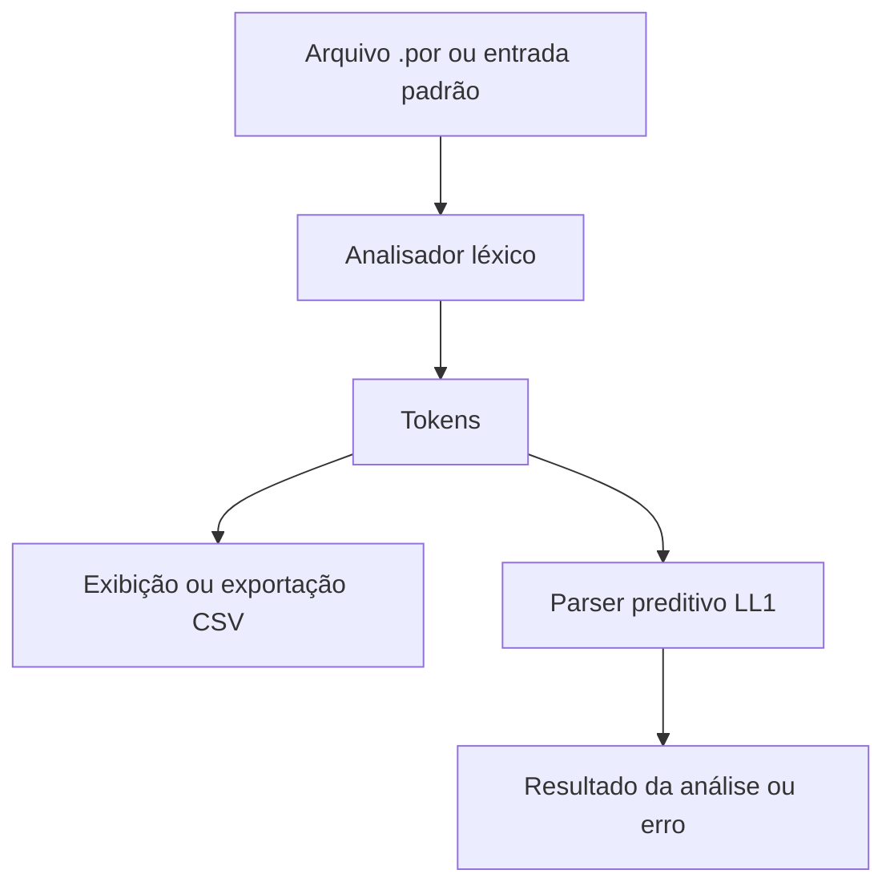

# Analisador léxico e sintático de Portugol

Projeto educacional em **C# / .NET 8** com analisador léxico e parser preditivo baseado em pilha. A CLI permite inspecionar tokens, exportar CSV e acompanhar derivações de uma linguagem inspirada em Portugol.

## Como funciona



A CLI usa `LexicalAnalyzer` e `LL1Parser`, definidos em [`Program.cs`](Program.cs). O repositório também contém a gramática ANTLR e arquivos gerados, mas a CLI principal implementa seu próprio caminho de análise.

## Requisitos

- .NET SDK com suporte ao alvo `net8.0` e acesso ao NuGet no primeiro restore.
- Java e ANTLR somente para trabalhar na geração dos arquivos da gramática.

## Compilar e executar

Na raiz do repositório:

```bash
dotnet build
dotnet run -- testes/teste_simples.por
dotnet run -- --tokens testes/teste_funcionalidades.por
dotnet run -- --csv --out saida/tokens.csv testes/teste_funcionalidades.por
dotnet run -- --verbose testes/teste_simples.por
dotnet run -- --help
```

Sem arquivo, a aplicação lê a entrada padrão. `--tokens` e `--csv` exibem a análise léxica e encerram o programa antes da análise sintática. `--out` é utilizado junto de `--csv`.

## Exemplo mínimo

O arquivo [`testes/teste_simples.por`](testes/teste_simples.por) contém:

```text
programa main()
inicio
    inteiro a = 10;
    inteiro b = 5;
    inteiro c = a + b;
    escreva(c);
fim
fimPrograma
```

A CLI verifica a análise; esse comando não executa o programa Portugol nem imprime o valor de `c`.

## Estrutura principal

| Caminho | Responsabilidade |
| --- | --- |
| [`Program.cs`](Program.cs) | CLI, analisador léxico e parser manual. |
| [`GrammarSpec/Portugol.g4`](GrammarSpec/Portugol.g4) | Especificação da gramática ANTLR. |
| [`Grammar/`](Grammar/) | Código C# gerado pelo ANTLR. |
| [`Interpreter.cs`](Interpreter.cs) | Código de interpretação separado do fluxo principal da CLI. |
| [`testes/`](testes/) | Arquivos de exemplo para validação manual. |
| [`docs/archive_md/`](docs/archive_md/) | Documentação histórica. |

## Validação e limites

- O parser contém rotinas e conjuntos FIRST/FOLLOW, mas a tabela preditiva é preenchida manualmente e a rotina de FOLLOW é parcial. O projeto não implementa um gerador geral de tabelas LL(1).
- A coluna exportada no CSV é calculada a partir do comprimento dos lexemas; não preserva a posição exata no texto, incluindo espaços.
- Os arquivos em `testes/` são exemplos manuais, não uma suíte automatizada. Não há cobertura medida.
- Esta revisão conferiu caminhos e comportamento por leitura do código; não executou novamente o projeto .NET.

O objetivo é o estudo de análise léxica e sintática. Não é um compilador de produção.
